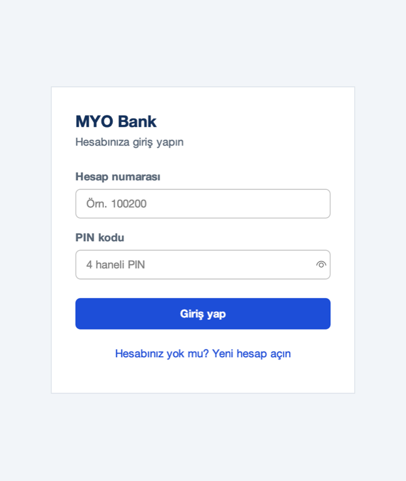
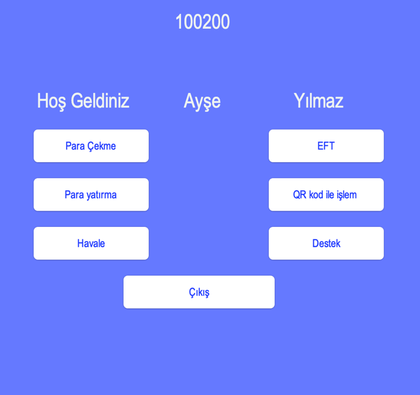

# 🏧 ATM Banka Simülasyonu

[](https://github.com/kaanyildiz14/atm-banka-simulasyonu/actions/workflows/ci.yml)


Bir ATM'nin hesap açma ve giriş akışını canlandıran Java Swing masaüstü uygulaması. Hesaplar SQLite veritabanında tutulur; arayüz [FlatLaf](https://www.formdev.com/flatlaf/) temasıyla modern bir bankacılık uygulaması görünümünde.

| Giriş | Ana ekran | Yeni hesap |
|---|---|---|
|  |  |  |

<sub>Ekrandaki hesap bilgileri hayalidir.</sub>

## ✨ Özellikler

- **Hesap açma:** Hesap no, ad, soyad, açılış bakiyesi, PIN, e-posta, şehir ve adres
- **Doğrulama:** Boş alan, 4-12 haneli hesap numarası, 4 haneli PIN, geçerli bakiye (`1500,50` ya da `1500.50`) ve e-posta biçimi kontrolü; aynı hesap numarasıyla ikinci hesap açılamaz
- **Giriş:** Hesap numarası ve PIN ile; PIN yazarken gizlenir (göz simgesiyle gösterilebilir), Enter ile giriş
- **Ana ekran:** Hesap sahibine selam, hesap numarası, Türk lirası biçiminde bakiye ve işlem menüsü
- **Güvenlik:** Tüm sorgular `PreparedStatement` ile parametreli; SQL injection denemeleri testlerle doğrulanıyor

## 🚧 Geliştirilmekte

Ana ekrandaki **Para çekme, Para yatırma, Havale, EFT, QR ile işlem ve Destek** kutucukları şimdilik "Yakında" olarak gösteriliyor. Planlanan geliştirmeler:

- Para çekme / yatırma ve havale (bakiye kontrolü ve veritabanı transaction'ı ile)
- İşlem geçmişi
- PIN'lerin hash'lenerek saklanması ve hatalı denemelerde hesap kilidi

## 🚀 Çalıştırma

Gereksinim: Java 17 veya üstü

**Hızlı yol:** [Releases](https://github.com/kaanyildiz14/atm-banka-simulasyonu/releases/latest) sayfasından `atm-banka-simulasyonu.jar` dosyasını indirip çift tıklayın ya da `java -jar atm-banka-simulasyonu.jar` ile çalıştırın.

**Kaynaktan derleme:**

```bash
git clone https://github.com/kaanyildiz14/atm-banka-simulasyonu.git
cd atm-banka-simulasyonu
./mvnw package                        # Windows: mvnw.cmd package
java -jar target/atm-banka-simulasyonu.jar
```

İlk çalıştırmada bulunduğunuz klasörde `banka.db` dosyası oluşturulur. **Yeni Kayit** ile bir hesap açıp o hesapla giriş yapabilirsiniz.

## 🧪 Testler

```bash
./mvnw test
```

15 test: form doğrulama kuralları ve her test için geçici bir SQLite dosyası üzerinde hesap açma, giriş, yanlış PIN, aynı hesap numarası ve SQL injection denemeleri.

## 📁 Yapı

```
src/main/java/bankaproje/
├── ATM.java             # Giriş ekranı (uygulamanın başlangıcı)
├── Tema.java            # Renkler, yazı tipi ve ortak bileşenler (FlatLaf)
├── ATManaekran.java     # Ana ekran / işlem menüsü
├── YeniKayit.java       # Yeni hesap formu
├── Hesap.java           # Hesap kaydı (record)
├── HesapDogrulama.java  # Form doğrulama kuralları
└── HesapDeposu.java     # SQLite işlemleri (kurulum, giriş, hesap açma)
src/test/java/bankaproje/  # JUnit testleri
```

## 📄 Lisans

[MIT](LICENSE)
